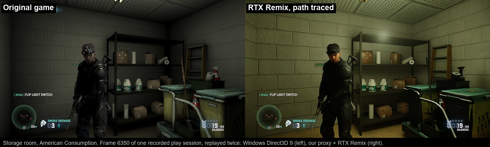
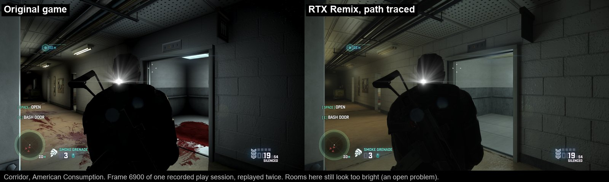
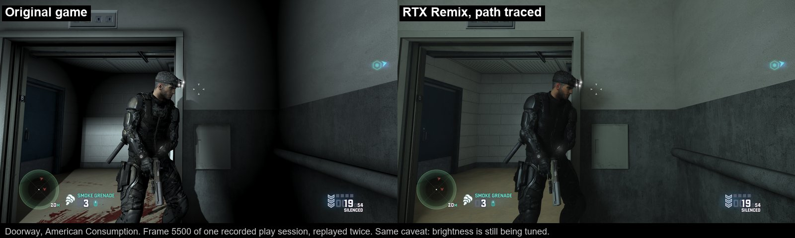
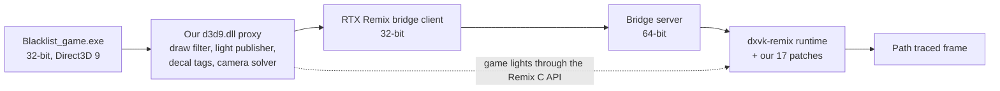

# Blacklist RTX Remix

Path tracing for *Tom Clancy's Splinter Cell: Blacklist* (Ubisoft, 2013) with NVIDIA RTX Remix.

Blacklist draws with Direct3D 9, which RTX Remix can hook. Out of the box it does not work well: Remix sees the wrong lights, the wrong camera, decals as solid black, and screen effects as world geometry. This repo is the glue that makes it playable: a small Direct3D 9 proxy DLL that sits between the game and Remix, a set of Remix settings, 17 patches to NVIDIA's Remix runtime, and a test setup that judges the picture with code instead of by eye.

It is a work in progress. Of 20 tracked graphics problems, 1 is fixed. See [docs/STATUS.md](docs/STATUS.md).

Each picture is the same frame of one recorded play session, replayed twice: once through Windows' own Direct3D 9 (left), once through our proxy and RTX Remix (right). The corridor and doorway show an open problem: rooms there are still too bright.

## How the pieces fit

- **The proxy** (`play-setup/unified-build/`) is a `d3d9.dll` the game loads instead of Windows' own. It wraps the Direct3D 9 device, decides which draws Remix should see (`draw_filter`), hashes decal textures so Remix can tag them as decals (`decal_tag`), picks the one real gameplay camera each frame and rejects shadow-map cameras (`camera_solver`), and reads the game's own renderer lights every frame and sends them to Remix through the Remix C API (`lightpub`, `light_calibration.h`). It then hands every call on to the Remix bridge.
- **The bridge** carries Direct3D 9 calls from the 32-bit game to the 64-bit Remix runtime. `play-setup/bridge.conf` holds our settings for it (one-frame queue to cut input lag, shared heap for dynamic buffers).
- **The Remix runtime** is NVIDIA's dxvk-remix 1.5.2 with our patches in `patches/dxvk-remix/` (telemetry, capture fixes, and the swap chain fix that stopped the quit crash). `play-setup/rtx.conf` holds our Remix settings.
- **Play and switch scripts** (`play-setup/*.ps1`) install the files into the game folder, start the game with Remix, turn Remix off again, and switch frame-rate and brightness options.

## Build

Windows only. Needs Visual Studio Build Tools version 18 (MSVC, x86 and x64).

- Proxy: `powershell -File play-setup/unified-build/build.ps1` builds the 32-bit `d3d9.dll`.
- Remix runtime and bridge: apply `patches/dxvk-remix/*.patch` to NVIDIA's dxvk-remix at tag `remix-1.5.2` (see that folder's README), then `build_custom_remix.ps1`.
- You need your own copy of the game and NVIDIA's RTX Remix 1.5.2 release. Neither is in this repo, and no built DLLs are.

The scripts were written for one build PC and still carry its folder paths (for example `D:\BlacklistOverhaul\...`). Expect to edit those.

## Test

The rule we work by: a problem counts as fixed only when a code check passes against the original game's number for the same frames, and switching the fix off brings the failure back. Every check must first catch a fault planted on purpose before we trust it.

- **Offline suite** (`tests/run_all_offline.ps1`): everything that runs without the game. C++ tests of the proxy's logic (`tests/verify_proxy_tests.cpp`, `tests/hitch/`, `tests/lightpub/`, `tests/remix_source/`), config and light checks, Python unit tests, and a parse check of every script.
- **Formal model** (`tests/formal/`): a TLA+ model of the Remix bridge's shared-memory data queue (`BridgeDataQueue.tla`), checked with TLC in about 15 seconds, with deliberately broken configurations that the check must catch.
- **Runtime gate** (`tests/verify_runtime.ps1`, `tests/runtime/`): launches the game straight into saved checkpoints, drives the camera through set stops by writing game memory, records frame times and pictures, and `gate.py` gives a numeric pass or fail. A `-NoRemix` run of the same spots gives the original game's numbers to compare against.
- **Frame replay rig** (branch `replay-rig`, `tests/replay/`): records a play session with apitrace and replays the exact same frames with and without Remix, so a change can be judged on identical input without a live launch. The pictures above come from it.

None of the test commands were run while preparing this public copy.

## How the work is done

The work is done by a crew of AI coding agents working from a ticket board, with one coordinating agent and the owner deciding. Each graphics problem is a ticket. Agents write the code, the checks and the commit messages; the commit history is theirs. The owner plays the game and makes the calls a person should make (which picture is right, which setting to keep).

## Status in numbers

- 20 graphics problems tracked, 1 closed (the crash on quit). The rest are in [docs/STATUS.md](docs/STATUS.md).
- Frame rate: the ray traced game ran at about 27 to 31 FPS in the owner's play videos. With Remix rendering at 1280x720 and upscaling to 2560x1440, one test run in one room read about 52 FPS on an RTX 3070 Ti. That is one run in one room. Frame times during real play have not been measured yet.

## History

This repo's history is a filtered copy of our private working repo: same commits and messages, with files that cannot be public removed from every commit (screenshots, worker notes, generated material data, logs, built binaries). Commits that only touched removed files are gone. The replay rig lives on its own branch, `replay-rig`, as it does in the working repo.

## License

Our code is under the MIT license: see [LICENSE](LICENSE). That covers everything in this repo except the parts below.

- `patches/dxvk-remix/` holds patches to NVIDIA's dxvk-remix, not standalone code of ours. dxvk-remix is NVIDIA's code under the MIT license, built on DXVK under the zlib/libpng license; both notices are kept beside the patches (`LICENSE-MIT.dxvk-remix`, `LICENSE-zlib.dxvk`), and the patches are offered under the same terms as the files they change.
- `play-setup/unified-build/ref/remix_c.h` is NVIDIA's Remix API header, under NVIDIA's MIT notice inside the file.
- `play-setup/unified-build/third_party/xxhash-0.8.2/` is xxHash, under its own BSD license in that folder.

Splinter Cell and Blacklist are trademarks of Ubisoft. RTX Remix is NVIDIA's. This project is not affiliated with either.
